<p align="center">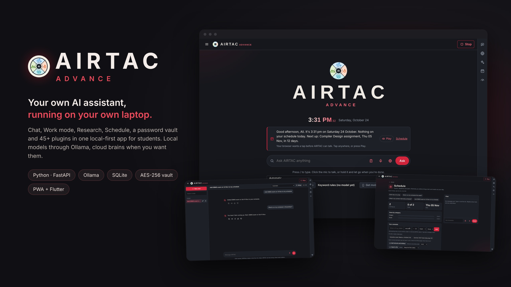</p>

<h1 align="center">AIRTAC Advance</h1>
<p align="center"><b>A local-first AI assistant for students, running on your own laptop.</b><br>
Chat, Work mode, Research, Schedule, a password vault and 45+ plugins in one app.<br>
Local models through Ollama, cloud brains only when you add a key. Your data stays on your machine.</p>

<p align="center">


</p>

---

## Watch it work (2:43)

**[▶ AIRTAC Advance walkthrough: every mode in under 3 minutes](docs/media/airtac-advance-walkthrough.mp4)**

Home → Chat → Work mode → Research → Web → AI apps → Apps & Social → Schedule → People & pipeline → Passwords → Settings & plugins.

---

## How it works

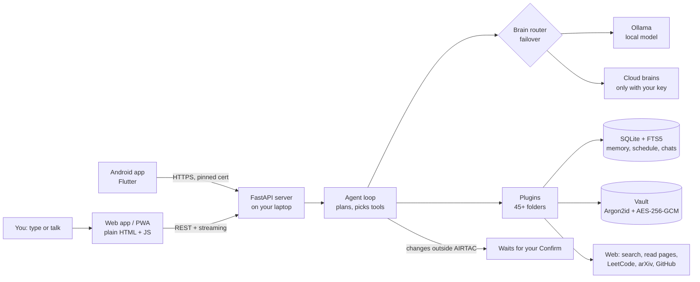

1. **You ask** on the web app, the phone app, or by voice.
2. **The agent** decides which plugin tools the question needs (schedule, web search, documents, memory…).
3. **The brain router** answers with the model on your laptop (Ollama). If you saved a cloud key, free cloud brains are tried first and the laptop stays the last stop, so AIRTAC still works offline.
4. **Plugins** do the real work. Each one is a folder with a `manifest.toml` that says which websites it may reach and whether it can change anything. Anything that changes something outside AIRTAC waits for your **Confirm**.
5. **Everything is stored locally** in SQLite. Passwords and API keys live in an encrypted vault the AI can never read.

---

## The modes

| | Mode | What it does |
|---|---|---|
| 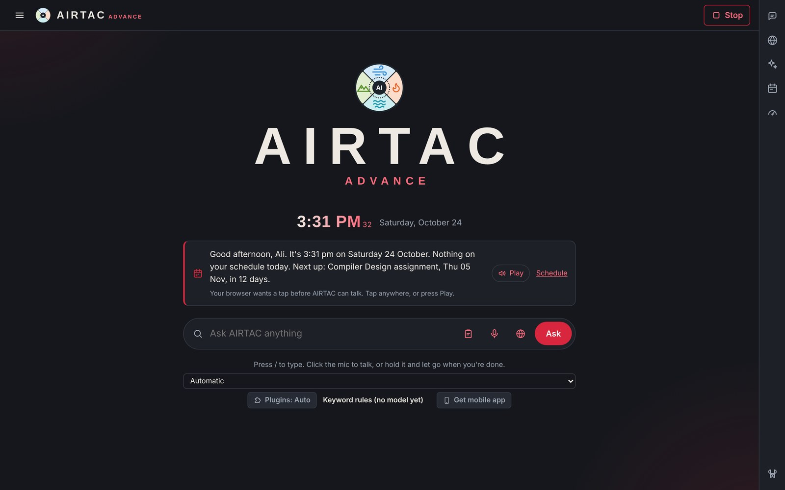 | **Home** | Greets you, reads out your day, one box to ask anything by typing or voice, and a brain picker (local or cloud). |
| 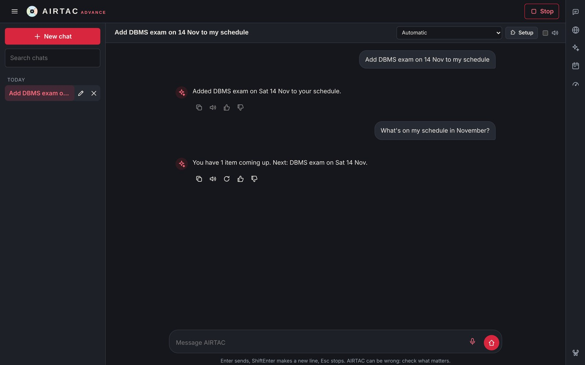 | **Chat** | Full assistant with history. Say "add my DBMS exam on 14 Nov" and the schedule plugin saves it. Every answer shows which plugin did the work. |
| 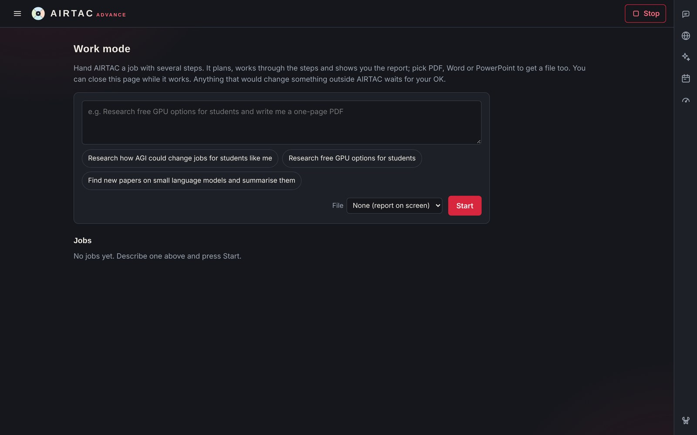 | **Work mode** | Hand over a job with several steps. It plans, works through them and gives a report, plus a PDF, Word or PowerPoint file. |
| 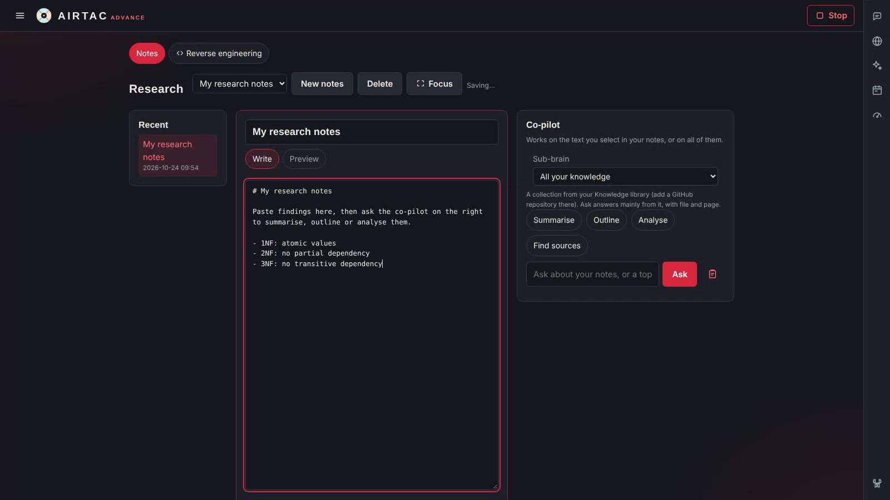 | **Research** | Markdown notes with an AI co-pilot (summarise, outline, analyse, find sources), plus reverse engineering: it finds an open-source repo and learns from it. |
| 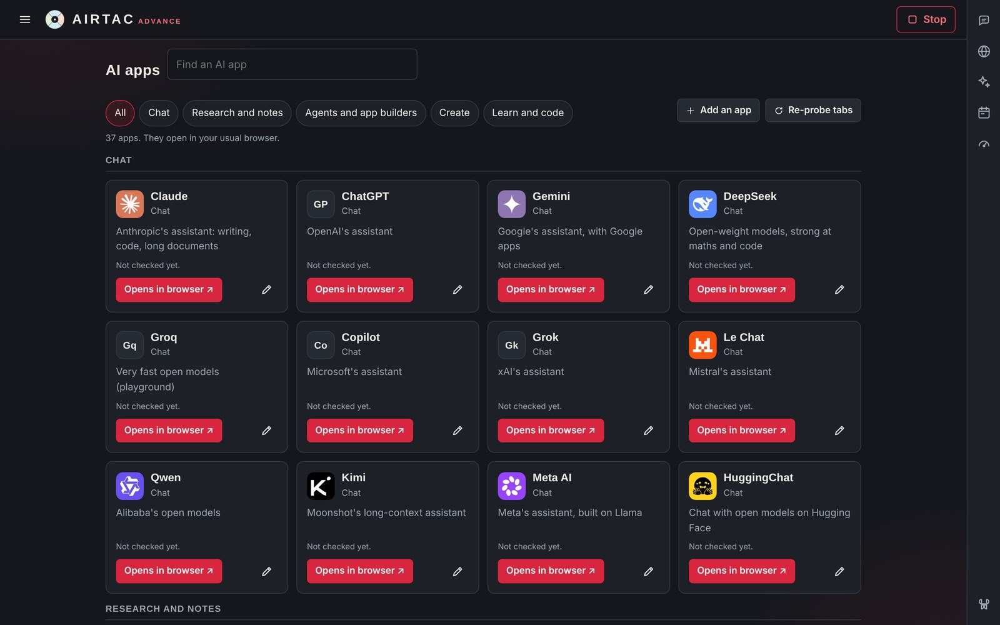 | **AI apps · Apps · Social** | One catalog for Claude, ChatGPT, Gemini, DeepSeek, Perplexity, Gmail, Drive, LeetCode, GitHub, WhatsApp, LinkedIn and more. |
| 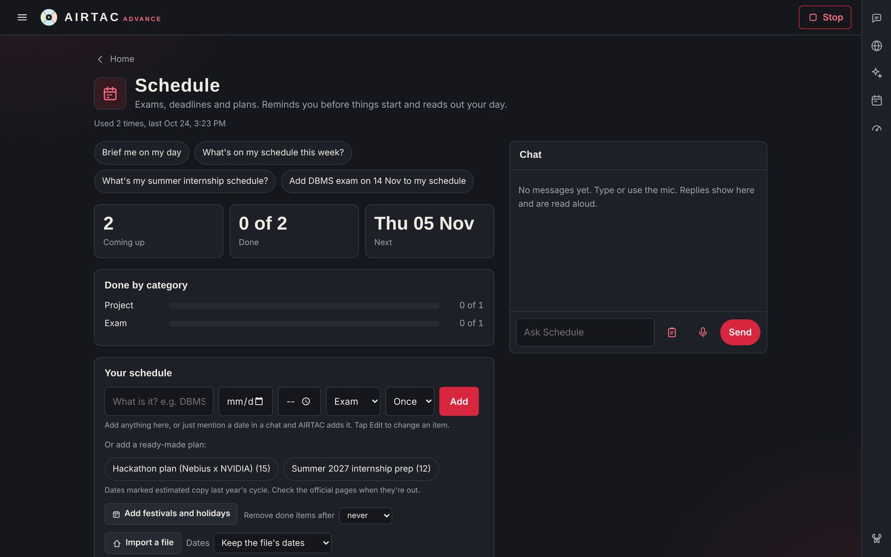 | **Schedule** | Exams, deadlines and plans. Import a timetable from PDF, photo (offline OCR), `.ics`, Word or Excel. Reminders fire on time. |
| 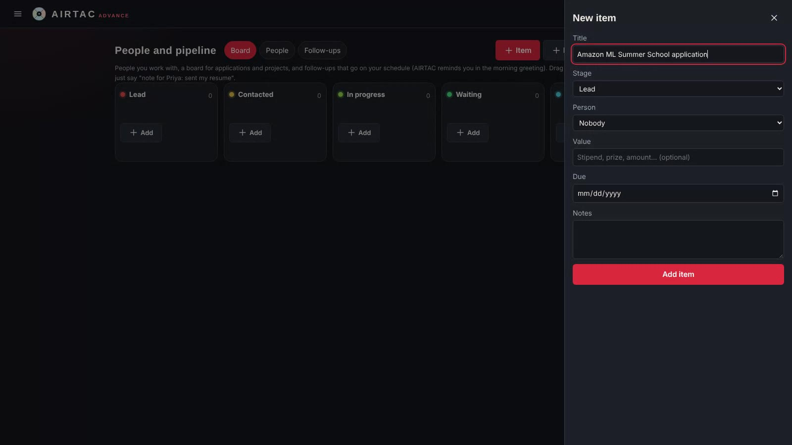 | **People & pipeline** | A board for internships and projects (Lead → Done). Follow-ups show up in your morning briefing. |
| 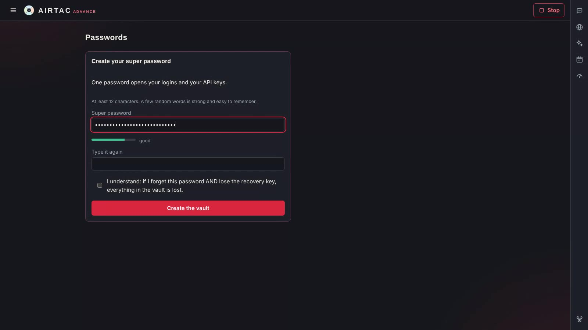 | **Passwords** | Encrypted vault: one super password, Argon2id + AES-256-GCM, recovery key, clipboard cleared after 30 s. |
| 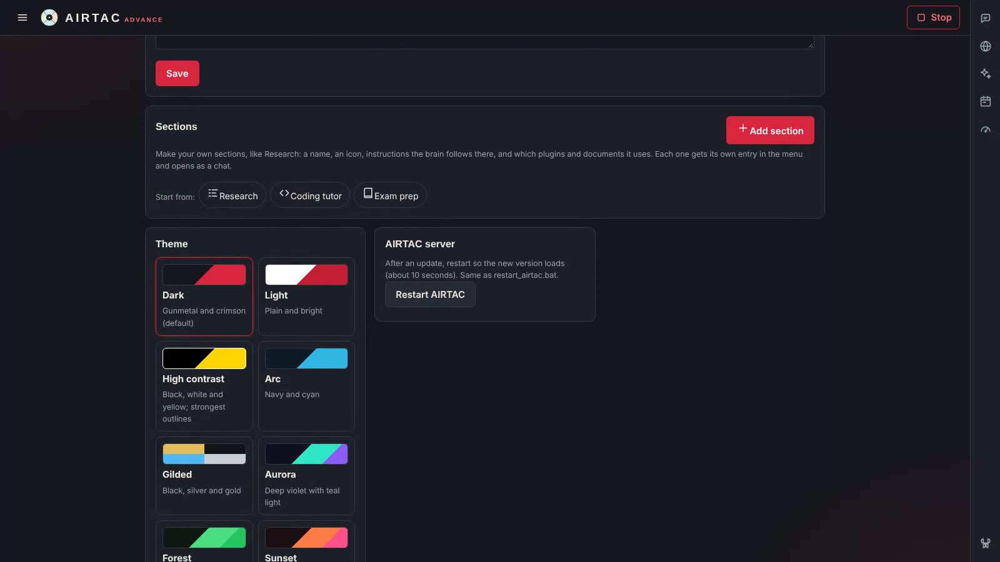 | **Settings & plugins** | Your own sections, eleven themes, plugins on/off. A new feature is a new folder in `plugins/`. |

---

## Tech stack

| Category | Used in AIRTAC Advance |
|---|---|
| **Languages** | Python 3.11+, JavaScript (ES2020, no framework), HTML5, CSS3, Dart, Kotlin, SQL (SQLite FTS5), PowerShell, Windows Batch, TOML, JSON, YAML, Markdown |
| **Backend frameworks & libraries** | FastAPI, Uvicorn, Pydantic, httpx, python-dotenv, fpdf2, Pillow, pypdf, python-docx, python-pptx, openpyxl, psutil, numpy, segno (QR), ddgs (web search), keyring, cryptography, argon2-cffi |
| **AI / ML** | Ollama (NVIDIA Nemotron 3 Nano, Qwen 3.5, Qwen 2.5 Coder, MedGemma, nomic-embed-text), faster-whisper (speech to text), RapidOCR + ONNX Runtime (offline OCR), RAG over a local knowledge library, tool-calling agent loop, multi-provider failover router |
| **LLM APIs** (optional, your own key) | Google Gemini, Groq, NVIDIA NIM (build.nvidia.com), Nebius Token Factory, OpenRouter, Hugging Face Inference, Cerebras, Cohere, Z.ai, Mistral, DeepSeek, Anthropic Claude, OpenAI, xAI Grok, Perplexity Sonar. All through one OpenAI-compatible client |
| **Other APIs** | GitHub REST, LeetCode GraphQL, Hacker News (Algolia), arXiv, Codeforces, Open-Meteo (weather), Google News RSS, Wikipedia, DuckDuckGo, Jina Reader, Tavily, Google Calendar / Gmail / Drive (connectors, OAuth) |
| **Frontend** | Single-page app in plain JS, PWA (web manifest + service worker), Web Speech API, View Transitions API, Content Security Policy |
| **Mobile** | Flutter (Android): flutter_secure_storage, mobile_scanner (QR pairing), flutter_inappwebview, local_auth (fingerprint), flutter_local_notifications, flutter_tts |
| **Databases & storage** | SQLite with FTS5 (memory, schedule, chats, notes, tokens), encrypted vault file, Windows Credential Manager (keyring), Android Keystore |
| **Security** | Argon2id + AES-256-GCM vault, Windows DPAPI, per-install token, SameSite=Strict cookies, certificate pinning for the phone, plugin network allow-lists, private-IP blocking, log secret redaction, Bandit, pip-audit, gitleaks |
| **Platforms** | Windows 10/11 (main), Android, any browser (PWA); runs on an Intel i3 with 8 GB RAM |
| **Cloud services** (optional) | Google Cloud (OAuth, Gemini, Cloud Storage test), Nebius AI Cloud, NVIDIA NIM, Hugging Face, rclone to your own cloud drive (encrypted backups), Tailscale (reach your PC from your phone) |
| **DevOps & testing** | pytest (570+ offline tests), GitHub Actions (Android APK build), Playwright (UI checks), Git, MCP server (links to coding agents) |

---

## Install (Windows)

1. Install **Python 3.11+** from python.org (tick *Add python.exe to PATH*).
2. Double-click **`Install-AIRTAC.cmd`**. It creates a private `.venv`, installs the packages, offers to install **Ollama** and downloads models that fit your RAM, then puts **AIRTAC Advance** on your desktop.
3. Double-click **AIRTAC Advance**. It opens in its own window and reads out your day.

Optional: `enable_autostart.cmd` starts the server (hidden, no window) when you sign in, so the app opens instantly.

### Run from source

```bash
python -m venv .venv
.venv/Scripts/python -m pip install -r requirements.txt     # Linux/macOS: .venv/bin/python
.venv/Scripts/python -m uvicorn airtac.main:app --port 8765
# open http://localhost:8765
```

No model installed yet? Set `[llm] provider = "mock"` in `config/airtac.toml` and AIRTAC runs on keyword rules.

### Phone

Settings → Devices → **Pair a phone** shows a QR code. The Flutter app in `mobile/` scans it and talks to your laptop over HTTPS with a pinned certificate. See [docs/MOBILE.md](docs/MOBILE.md).

---

## Project structure

```
airtac/      core: FastAPI app, agent loop, brain router, memory, scheduler, Work mode, web search, vault, pairing
plugins/     one folder per feature (manifest.toml + __init__.py), 45+ plugins
web/         the app: one HTML page, plain JS and CSS, service worker, logos
mobile/      Flutter Android app (Airtac Mobile)
scripts/     installer, start/stop, doctor, security check, new-plugin generator, MCP server
config/      airtac.toml (settings; secrets never go here)
tests/       pytest, fully offline (no network, no model)
docs/        architecture, plugins, security, manual, tech stack
```

## Write a plugin

```bash
.venv/Scripts/python scripts/new_plugin.py weather "Weather" "Today's weather."
```

This creates `plugins/weather/` with a manifest, a starter tool and a test. Restart AIRTAC and it shows up on the Plugins page. Details: [docs/PLUGINS.md](docs/PLUGINS.md).

## Tests

```bash
.venv/Scripts/python -m pytest -q        # 570+ tests, offline
.venv/Scripts/python scripts/security_check.py   # pip-audit + bandit + gitleaks
```

## Docs

[Architecture](docs/ARCHITECTURE.md) · [Plugins](docs/PLUGINS.md) · [Security](docs/SECURITY.md) · [User manual](docs/USER_MANUAL.md) · [Tech stack](docs/TECH_STACK.md) · [Mobile](docs/MOBILE.md) · [Roadmap](docs/ROADMAP.md)

## License

MIT for AIRTAC Advance's own code. Models and tools keep their own licences: see [docs/OPEN_SOURCE.md](docs/OPEN_SOURCE.md).

<p align="center">Built by <b>Mohammad Tawheed Ali</b> · B.Tech CSE (AI &amp; ML)</p>
